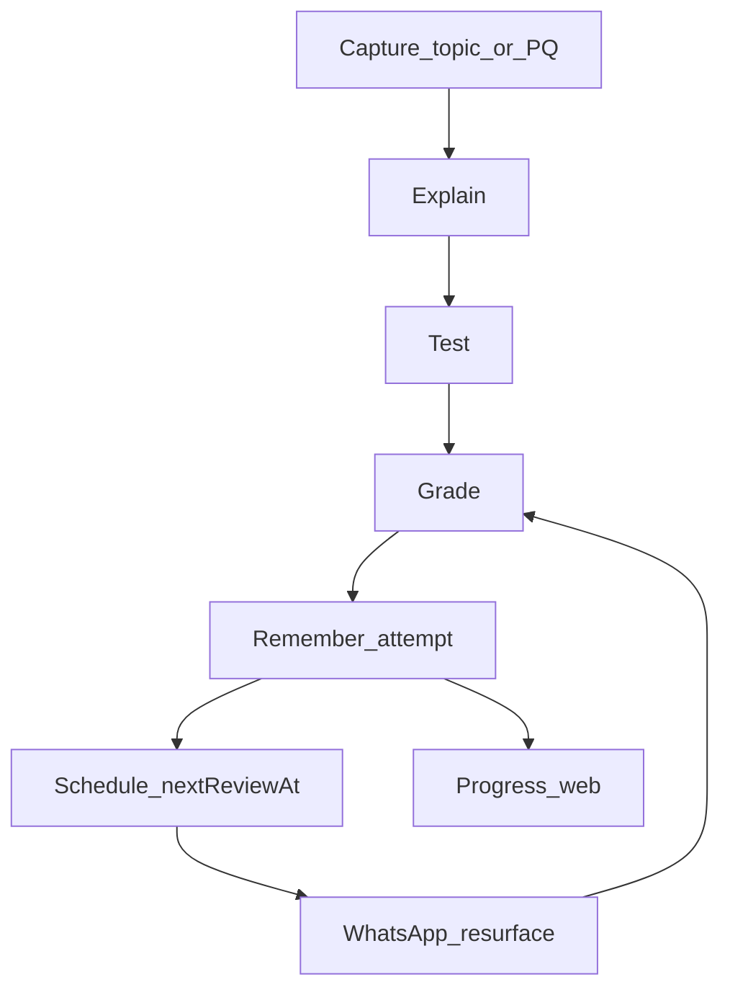

# Reca — Information architecture

**Product:** Reca rebuild  
**Surfaces:** Web app (primary study) + WhatsApp (required resurface)  
**Last updated:** 2026-09-10  
**Depends on:** [vision.md](./vision.md), [discovery.md](./discovery.md)

---

## Primary job per surface

| Surface | Primary action (must be obvious in 2s) |
|---------|------------------------------------------|
| Learn | Start or continue a topic explanation |
| Revise | Practise a weak topic or past-question style item |
| Progress | See what needs work / open next review or link WhatsApp |
| WhatsApp (inbound) | Answer the resurfaced question or send a topic |
| Profile | Link WhatsApp; set exam body + subjects |

---

## Web — sitemap

```text
/                 → redirect to Learn or last tab
/learn            → subject list → topic → explain session
/learn/:subject/:topic
/revise           → default: recommended practise (weak first)
/revise/past      → past-question style (segment WAEC | JAMB)
/revise/session/:id
/progress         → subject recap + weak / strong / cleared
/progress/:subject
/profile          → WhatsApp link, exam preference, subjects
/auth             → sign-in / sign-up (phone-forward identity)
```

### Tab bar (mobile-first)

1. **Learn**  
2. **Revise**  
3. **Progress**  

Profile via avatar / gear in header — not a fourth primary tab (settings that aren’t the daily job stay secondary; WhatsApp link is surfaced on Progress when missing — #2).

---

## Learn

**Job:** Understand.

### Hierarchy

1. Subject (Biology, Chemistry, …)  
2. Topic list (syllabus-aligned packs)  
3. Topic session: explanation → optional diagram/calculation → handoff CTA **Practise this** → Revise  

### Rules

- One primary CTA on topic complete: **Practise this** (#2).  
- Labelled diagrams: curated packs only (see [curriculum.md](./curriculum.md)).  
- Empty Learn: pick a core subject; no orphan “explore the universe of AI.”

---

## Revise

**Job:** Practise until it sticks.  
**Flow detail:** [flows/revise.md](./flows/revise.md)

### Hierarchy

1. **Board** — segment **WAEC | JAMB** (sticky preference)  
2. **Recommended** (default) — weak topics due / overdue  
3. **By subject** — mixed exam-style set for that subject  
4. **By topic** — browse / search one topic  

Past-question style lives **inside** this tab (not a fourth root). Secondary: **Snap a past question**.

### Past questions (locked)

- Hub title: **Past questions**  
- Primary: Recommended / subject / topic with exam meta  
- Secondary: full-width **Snap a past question** (photo → explain → practise)  
- Preference: exam body stored (web + API `examBody`)  
- Do **not** claim official scanned papers without a licensed bank  

### Session

- Default **8** questions; **Keep going (+5)** on summary; Learn quick-check stays **2**  
- Questions one-at-a-time on small screens  
- Grade inline; miss → memory promise copy (voice.md)  
- End state: Keep going · Progress · Quiz again / hub  

---

## Progress

**Job:** Know what you don’t know.

### Content

- Per subject: **Strong** / **Needs work** / **Cleared**  
- Next reviews due (countdown or date)  
- If WhatsApp not linked: persistent but non-modal banner — **Link WhatsApp so Reca can message you first** (primary CTA)  

### Rules

- Progress reads the **same** attempt store as WhatsApp.  
- No fake scores or “predicted UTME.”  

---

## Profile

- Link / unlink WhatsApp (unlink warns: resurfaces stop)  
- Exam body default: WAEC | JAMB  
- Subjects following (core five default on)  
- Opt out of resurfaces (allowed; Progress explains consequence)  

---

## WhatsApp — conversation IA

Not a site map — a **thread grammar**.

| User intent | Reca behaviour |
|-------------|----------------|
| First message / `hi` | Onboarding blurb + example topic |
| `explain {topic}` | Explain → Q1 (then Q2) |
| Answer to open question | Grade → memory line if miss |
| `how am I doing` / subject recap | Strong / needs work / cleared |
| Unprompted (system) | `Quick recall — {question}` only |
| Photo (post-slice) | Explain this question → practise |
| Malpractice ask | Refuse + offer explain→practise |

Identity: phone number = student key; must map to web account (see [rebuild-tech.md](./rebuild-tech.md)).

---

## Shared memory loop (both surfaces)



---

## Cross-links (no dead ends)

| From | To |
|------|-----|
| Learn topic end | Revise session for that topic |
| Revise miss | Progress “needs work” (data) + WhatsApp schedule |
| Progress weak row | Start Revise session |
| Progress no WhatsApp | Profile link flow |
| WhatsApp cleared | Optional “Want another topic?” → user may open web Learn |

---

## States

Per-screen empty / loading / error / success: [states.md](./states.md).
