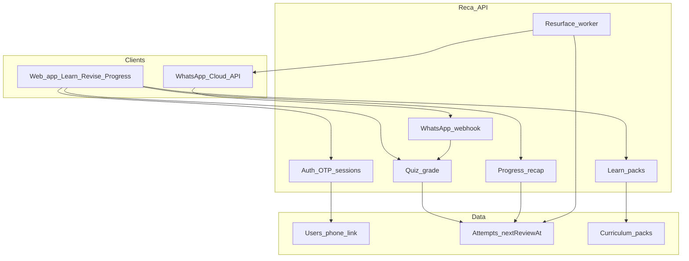

# Reca — Technical rebuild plan

**Product:** Reca rebuild  
**Depends on:** [vision.md](./vision.md), [ia.md](./ia.md), [curriculum.md](./curriculum.md)  
**Last updated:** 2026-09-10  
**Fest baseline:** [technical-prd.md](./technical-prd.md), [`backend/`](../../backend/)

This document plans the rebuild. It does not replace runtime code until implementation sprints start.

---

## Goals

1. **Web app = primary UX** for Learn / Revise / Progress (not `chat.html` as the product).  
2. **WhatsApp = required delivery path** for unprompted resurface (decision 0002).  
3. **One identity, one memory** — attempts and weak topics shared across surfaces.  
4. Keep proven fest pieces: attempt store, resurface scheduler, quiz/diagram/calculation packs, security habits.

---

## Target architecture

---

## Identity model

| Concept | Rule |
|---------|------|
| **Canonical key** | `userId` (UUID) |
| **WhatsApp link** | E.164 phone → `userId` (unique) |
| **Web session** | Cookie/JWT after OTP or passwordless phone auth |
| **Linking** | Profile OTP proves phone; merges guest web attempts into `userId` if any |
| **Unlink** | Keeps attempts; stops outbound resurface |

Fest used phone as WhatsApp identity and optional web sync — **rebuild makes explicit merge + required link for full loop.**

---

## What to keep from `backend/`

| Asset | Keep / adapt |
|-------|----------------|
| Explain → quiz → grade loop | Keep; expose clean REST for web |
| Attempt + `nextReviewAt` | Keep; move durable store (DB) for pilot |
| Resurface cron / demo trigger | Keep; production worker + idempotency |
| Diagram packs / calculation packs | Keep registries; expand per curriculum.md |
| WhatsApp webhook + signature verify | Keep ([security.md](./security.md)) |
| Preset curriculum fallback | Keep for reliability when LLM fails |
| `chat.html` | Demote to **dev/demo harness**, not product UI |

---

## What to build new

| Piece | Notes |
|-------|-------|
| Web app shell | Tabs: Learn / Revise / Progress + Profile |
| Pack-driven Learn UI | Topic explain + diagram/calc views |
| Revise sessions | Weak-first queue; past-question segment; snap upload (next slice) |
| Progress UI | Same aggregates as WhatsApp recap |
| Auth + WhatsApp link | OTP; required for resurface |
| Shared grading service | One grader both clients call (webhook thin) |
| Content pipeline | JSON packs + reviewer meta |

---

## Spaced repetition

| Stage | Behaviour |
|-------|-----------|
| **Rebuild MVP** | Fixed intervals (e.g. miss → 1d → 3d → 7d); compress only for demos |
| **Post-MVP** | SM-2-style adaptive intervals from attempt history |

Do not block rebuild on perfect SM-2.

---

## API sketch (logical)

- `POST /auth/otp/start` / `POST /auth/otp/verify`  
- `POST /me/whatsapp/link`  
- `GET /subjects` / `GET /subjects/:id/topics`  
- `GET /topics/:id` (explain payload + pack refs)  
- `POST /quiz/start` `{ topicId, examBody? }`  
- `POST /quiz/answer` `{ attemptId, answer }` → grade + schedule  
- `GET /progress` / `GET /progress/:subject`  
- `POST /webhooks/whatsapp` (existing)  
- Worker: `resurface.due` → send WhatsApp template/session message  

Exact paths can match existing backend naming during migration.

---

## Non-functional

- Rate limits on auth, chat, upload, webhook (existing direction)  
- No secrets in repo; verify WhatsApp signatures in production  
- Low-data: compress images; prefer text packs; lazy-load diagram assets  
- Accessibility: 44px targets, focus states, contrast (#7)  
- `prefers-reduced-motion` on web motion (#5)

---

## Migration sequence

1. Durable DB for users + attempts (replace in-memory for pilot)  
2. Auth + WhatsApp link  
3. REST for Learn/Revise/Progress  
4. New web UI against API  
5. Point resurface worker at same attempts  
6. Retire product reliance on `chat.html`  
7. Expand packs (curriculum.md)  

---

## Explicit non-goals (tech v1)

- Native iOS/Android apps (responsive web first)  
- Fine-tuned private models on uploads  
- Real-time multiplayer classes  
- Parent dashboards  

---

## Definition of done (tech slice)

- [ ] Same `userId` answers on web and WhatsApp update one Progress view  
- [ ] Miss on web → WhatsApp resurface fires when due  
- [ ] Miss on WhatsApp → Progress shows needs work  
- [ ] Unlinked user cannot receive resurfaces; UI explains why  
- [ ] Pack miss (diagram) shows honest empty, not invented labels
